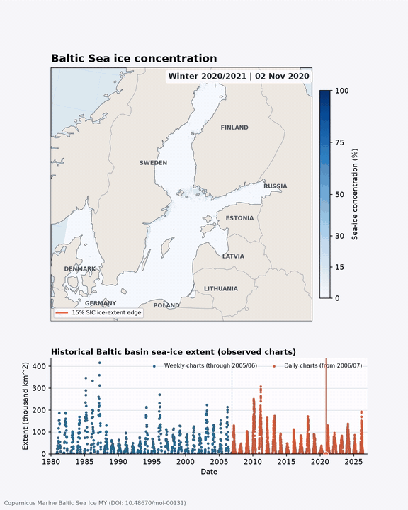
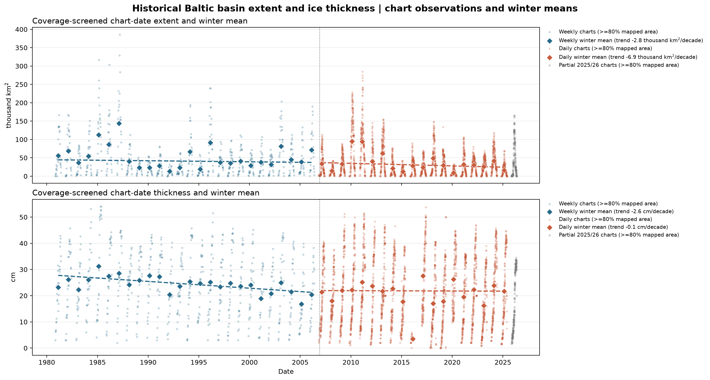

# Baltic Ice Atlas

This project uses Finnish Meteorological Institute ice charts distributed by Copernicus Marine to describe Baltic Sea ice conditions.

## Results

The animation follows sea-ice concentration across five recent winters. Its lower panel shows the basin-wide extent record.

[Download the GIF](figures/baltic_ice_atlas_recent_winters.gif)



The historical chart shows individual weekly or daily observations and the mean for each complete winter. Extent is calculated as the area of grid cells with at least 15% sea-ice concentration. Thickness is averaged over mapped ice using cell-area weights. Dashed lines show separate Theil-Sen trends for the weekly and daily chart periods.



## Data and methods

The source data are not included. The processed chart-date and winter-summary tables are included under `data/processed/`; use them to recreate the historical figure without downloading the full archive.

The chart archive is weekly through winter 2005/06 and daily from winter 2006/07. A chart observation is included in the plotted series only when at least 80% of the basin grid is mapped. The 2025/26 winter is partial and does not enter the winter-mean trend lines. Trend lines are descriptive; this project does not estimate uncertainty or attribute causes.

The full-basin SIC and thickness archive is large (about 95 GB for the historical retrieval). It is not needed to view the results or redraw the historical figure. The animation needs five recent SIC subsets and a compact extent series; the retrieval script estimates the download size before starting.

Data sources: [Copernicus Marine Baltic Sea Ice product](https://data.marine.copernicus.eu/product/SEAICE_BAL_PHY_L4_MY_011_019/description), [Product User Manual](https://documentation.marine.copernicus.eu/PUM/CMEMS-SEAICE-PUM-011-019.pdf), [Quality Information Document](https://documentation.marine.copernicus.eu/QUID/CMEMS-SEAICE-QUID-011-004-011-019.pdf), and [SMHI sea-ice indicator](https://www.smhi.se/en/climate/tools-and-inspiration/climate-indicators/sea-ice).

## Run the notebooks

On Windows, create the environment and start JupyterLab:

```powershell
conda env create -f environment.yml
conda activate baltic-ice-atlas
jupyter lab
```

Run `01_historical_figure.ipynb` to redraw the included time series from the processed tables. Run `02_full_archive_analysis.ipynb` only if you have downloaded the full historical archive. Run `03_baltic_ice_animation.ipynb` to rebuild the GIF.

To prepare the animation data, first estimate the required space:

```powershell
python scripts/download_animation_data.py
```

If the estimate fits your available disk space, add `--download`. Copernicus Marine credentials must be configured locally with the Copernicus Marine Toolbox; never put them in this repository. The historical archive can be retrieved with `python scripts/download_historical_basin_data.py --download` after the five recent SIC subsets are present.

See [`data/README.md`](data/README.md) for the included tables and data paths.
